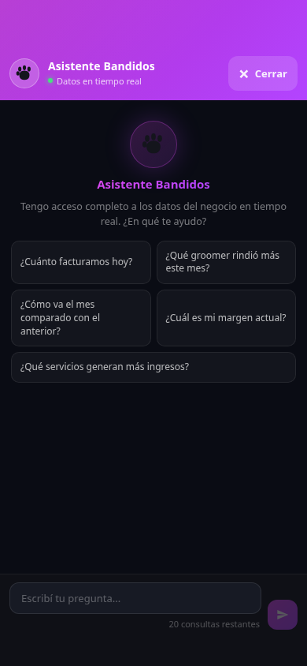
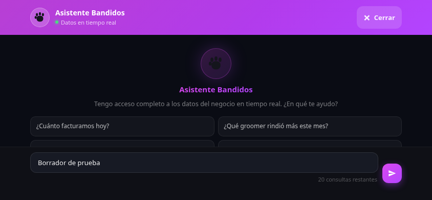

# Asistente: cierre accesible en celular

El panel completo respeta las áreas seguras del teléfono: barra superior,
isla/notch, márgenes laterales al girarlo e indicador inferior. El botón ahora
muestra «× Cerrar» y mide al menos 88 × 44 píxeles CSS.

Cuando cambia el área visible por el teclado o la orientación, el panel ajusta
su tamaño y posición con VisualViewport. Si esa API no está disponible, usa
las dimensiones de la ventana. Escape cierra el asistente y el foco vuelve al
botón IA. Se conserva el borrador al cerrar y reabrir.

No cambia consultas, cuotas, datos ni permisos. No requiere migración.

## Capturas de demostración

Estas capturas usan datos ficticios en Chromium y áreas seguras simuladas;
no representan una prueba en Safari ni en un iPhone físico. En vertical se
simularon 59 px arriba y 34 px abajo; en horizontal, márgenes laterales de 59 px.

Validación: 22 pruebas, build/PWA y ESLint del componente pasan. En navegador
se verificaron clic de cierre, devolución del foco, Escape, borrador conservado,
conversación larga, área visible reducida y desplazada por teclado simulado,
orientación horizontal, navegador sin VisualViewport y escritorio de poca
altura. La respuesta de IA fue simulada; no se enviaron consultas reales ni se
consumió cuota de producción.
