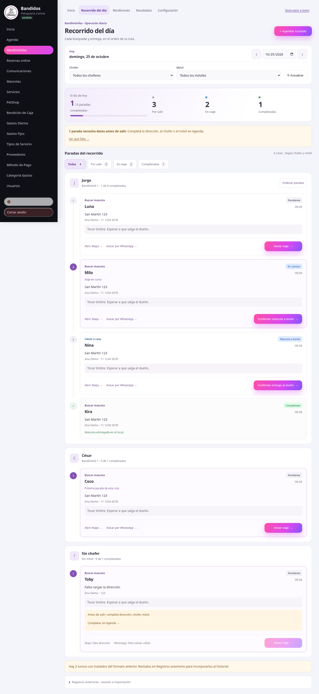
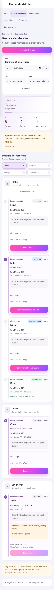
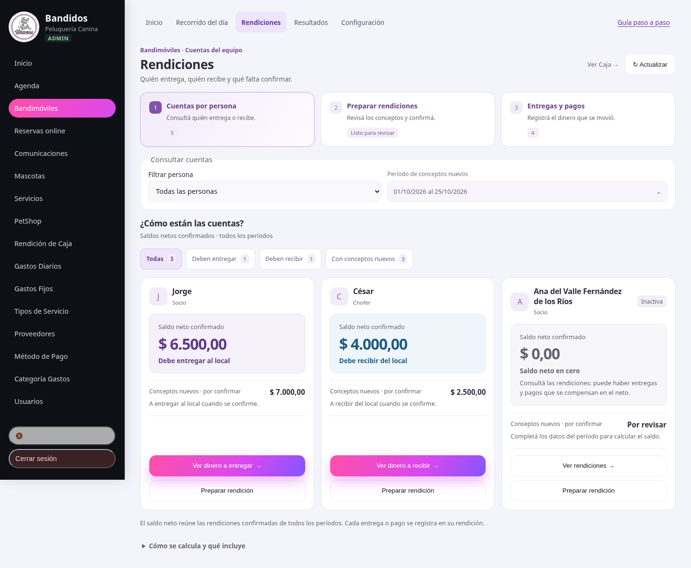
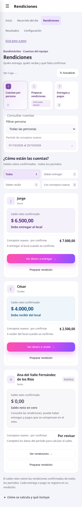
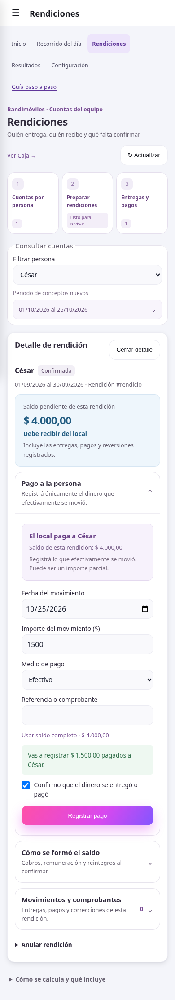

# Recorrido y rendiciones: acciones más claras

Recorrido del día muestra el avance y las paradas en una secuencia visual por
chofer y móvil. Se puede ver todo, solo lo que falta salir, los viajes en curso
o las paradas completadas. Cada tarjeta indica qué hay que hacer: iniciar viaje,
confirmar que la mascota está a bordo o confirmar su llegada al destino.

Los datos faltantes se muestran junto a la parada y se explica cómo completarlos.
El aviso del resumen lleva a la primera parada que necesita datos. Maps y
WhatsApp siguen usando la dirección y el teléfono del tramo. Una parada
completada conserva su información y ocupa menos espacio.

Ordenar paradas es una acción secundaria explícita del administrador. Se ofrece
solo en la vista completa, para guardar el orden con todos los IDs y revisiones
de esa ruta. Los filtros de estado no reordenan datos ni alteran las posiciones
de las paradas. Los históricos e importaciones quedan plegados al final.

Rendiciones separa tres tareas:

1. **Cuentas por persona:** consultar quién debe entregar o recibir, filtrar por
   situación y distinguir el saldo confirmado de los conceptos nuevos.
2. **Preparar rendiciones:** revisar pendientes, elegir una persona y confirmar
   sus conceptos. Confirmar conserva el saldo y no registra dinero.
3. **Entregas y pagos:** consultar las rendiciones confirmadas y registrar el
   dinero en la rendición que corresponde, incluso si es un importe parcial.

El período de conceptos nuevos se consulta y cambia desde un desplegable. Los
saldos confirmados y el historial siguen abarcando todos los períodos. Se aclara
que un neto por persona en cero puede reunir rendiciones de sentidos contrarios;
las acciones de cada rendición se conservan y no se compensan automáticamente.

El formulario de movimiento identifica quién entrega o recibe, ofrece completar
el importe con el saldo total y anticipa qué se va a registrar. Exige un importe
positivo dentro del saldo, conserva la confirmación explícita y admite pagos
parciales. Un saldo desconocido no habilita un movimiento de dinero.

Cambiar de tarea conserva los borradores de revisión mientras no cambie la
consulta cargada. Al cerrar un detalle, el foco vuelve al origen o al título de
la vista visible. Los títulos del encabezado móvil identifican Recorrido del día,
Rendiciones y Mis traslados para el chofer.

## Comprobaciones

- Build de producción/PWA y las cinco suites de `npm test` aprobados. Se agregó
  cobertura de cancelaciones, avance, filtros de estado y datos faltantes.
- ESLint aprobado en todos los archivos nuevos y modificados; `git diff --check`
  sin problemas. El build conserva sus avisos previos de `step` duplicado en
  PetShop y tamaño del bundle.
- Chromium con API simulada: filtros de fecha, chofer y estado; orden completo
  con revisiones; secuencia de estados independiente para búsqueda y entrega;
  datos faltantes y foco; enlaces correctos; error de carga y reintento.
- Cuentas por situación, historial por persona, entregas y pagos parciales,
  importe completo, importe superior al saldo, confirmación explícita y
  reintento del movimiento con el mismo ID. Confirmar una rendición no genera
  un movimiento automático.
- Neto cero con rendiciones de sentidos contrarios, preparación y revisión de
  pendientes, conservación de borradores al cambiar de tarea y retorno de foco
  al cerrar un detalle. Sin desbordes de 320 a 1440 px ni errores JavaScript.
- El chofer mantiene la redirección a sus traslados y no ve controles de
  administración, importación, orden ni enlaces para editar Agenda.

Las capturas y pruebas usan datos ficticios. No se accedió a producción ni se
enviaron mensajes. La implementación no cambia el backend, los estados de la
API, los cálculos financieros ni los IDs de reintento; no requiere migraciones.
Se verificó en Chromium con tamaños de celular y escritorio, no en Safari o un
teléfono físico. Los cambios todavía no están publicados.

## Capturas

