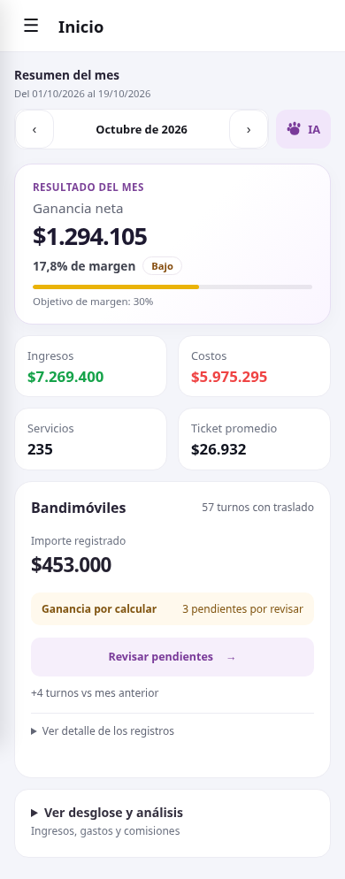
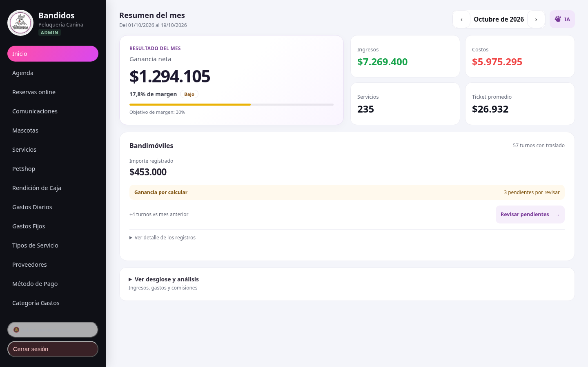

# Inicio: propuesta visual

La ganancia y el margen comparten una tarjeta principal. Ingresos, costos,
servicios y ticket promedio forman una grilla de cuatro indicadores.
Bandimóviles resume los importes registrados y permite revisar pendientes;
el detalle conserva separadas las fuentes anteriores y los cobros explícitos.
El desglose económico se despliega y el acceso a IA está en el encabezado.

Estas capturas usan respuestas ficticias con importes de referencia del ejemplo
compartido por el usuario. No verifican datos ni operaciones de producción.
No se modificaron fórmulas económicas ni se requiere una migración.

## Celular

## Escritorio

Validación: 22 pruebas, build/PWA y ESLint de los JavaScript modificados pasan.
Comprobación visual y funcional a 320, 375, 390, 768, 1024 y 1440 px: fuentes
mixtas, resultado cero, fallo de consulta, pérdida, importes grandes, período
vacío, detalles, navegación por mes y apertura/cierre de IA sin enviar mensajes.
