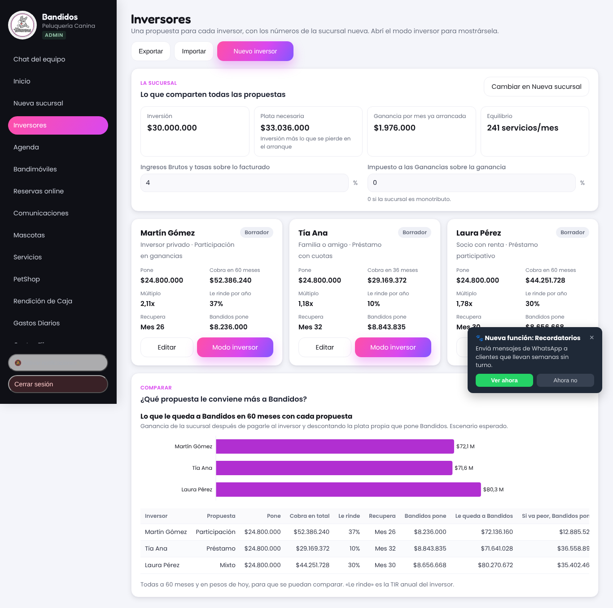
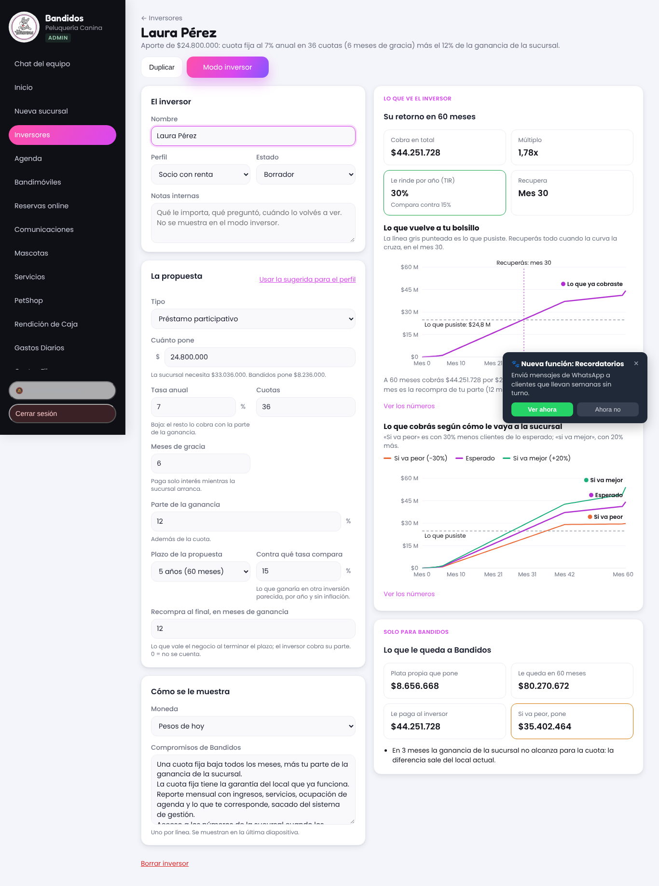
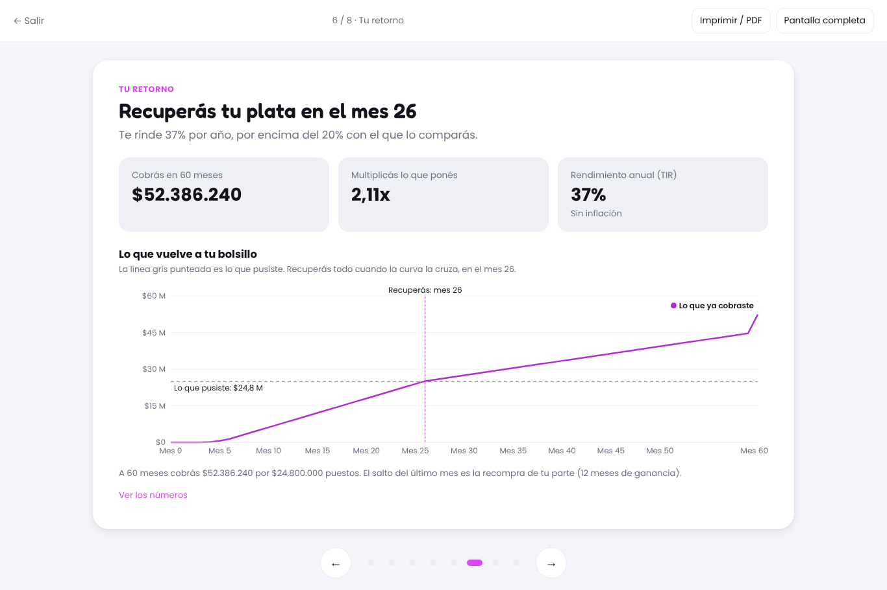
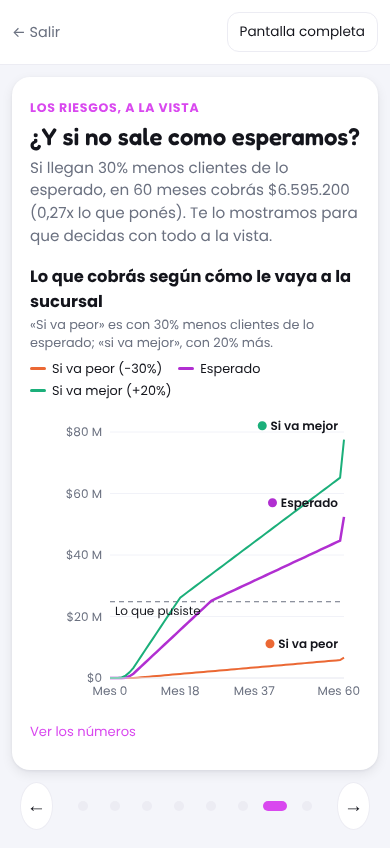

# Inversores y modo inversor

Pantalla **Inversores** (`/inversores`, solo admin, en el menú debajo de
Nueva sucursal). Una propuesta por inversor para la misma sucursal nueva, y un
**modo inversor** para mostrársela con gráficos. Las cuentas están en
`src/lib/inversion.js` y `src/lib/inversores.js` (con tests); el porqué de cada
forma de propuesta, en `docs/plan-inversion-sucursal.md`.

## De dónde salen los números

- **La sucursal** sale del simulador de `/nueva-sucursal`: inversión (total o
  por partes), fijos, ticket, comisión, insumos, servicios, arranque gradual y
  capacidad. Se cambia allá y todas las propuestas se actualizan.
- **El local hoy** (para la diapositiva «El modelo ya funciona»): Nueva
  sucursal guarda un resumen al abrirse (ingresos, servicios, ticket, margen,
  ocupación de agenda y crecimiento). Sin ese resumen, la diapositiva no sale.
- **Impuestos** comunes a todas: Ingresos Brutos sobre lo facturado y Ganancias
  sobre la ganancia (0 si es monotributo).
- Todo va en **pesos de hoy**, sin inflación. La propuesta se puede mostrar en
  dólares con el tipo de cambio que se cargue.

## Lista y comparación

- «Nuevo inversor» pide el perfil (inversor privado, familia o amigo, banco,
  socio con renta) y arranca con la propuesta que mejor le suele cerrar, por el
  75% de la plata necesaria.
- Cada tarjeta: cuánto pone, cuánto cobra, múltiplo, TIR, recupero y cuánto
  pone Bandidos. Estado: borrador, presentada, negociando, aceptada, no avanzó.
- Con dos o más, **comparar**: todas a 3 años, lo que le queda a Bandidos con
  cada una y cuánto tendría que poner si la sucursal va 30% peor.
- **Exportar / Importar**: los inversores se guardan en este navegador (como el
  simulador). El archivo sirve de copia y para pasarlos a otra compu.

## Editor de la propuesta

- Tres tipos: **participación** (con opción de cobrar más hasta recuperar),
  **préstamo** (francés, con meses de gracia que pagan solo interés) y
  **préstamo participativo** (cuota baja + parte de la ganancia).
- Plazo de 3 en 3 meses, de 3 meses a 3 años; tasa contra la que compara el
  inversor y recompra al final en meses de ganancia (se valúa con la ganancia
  de la sucursal ya arrancada, aunque el plazo sea corto). Las propuestas
  viejas a 5 años pasan a 3.
- Si las cuotas de un préstamo terminan después del plazo, al final del plazo
  Bandidos devuelve el saldo: el editor lo avisa y el modo inversor lo explica.
- La sucursal (plata necesaria, ganancia ya arrancada, servicios) se mira
  siempre a 3 años, aunque la propuesta sea más corta.
- Vista previa en vivo: lo que ve el inversor y, aparte, **«Solo para
  Bandidos»**: plata propia, lo que le queda, lo que se lleva el inversor,
  cuánto pondría si va peor y avisos (meses en que la ganancia no cubre la
  cuota, propuesta que no le rinde al inversor lo que pide, inversor que pone
  el 100%).
- Notas internas y compromisos (uno por línea, salen en la última diapositiva).

## Modo inversor

`/presentacion/inversores/:id`: pantalla completa, sin el menú. Flechas del
teclado, botones o puntos para pasar; «Pantalla completa» e «Imprimir / PDF»
(una diapositiva por hoja A4 apaisada). Nunca muestra lo de Bandidos ni las
notas.

Al imprimir (con el botón o con Ctrl+P) se muestran todas las diapositivas y
los gráficos se dibujan con ancho fijo para la hoja (`printContext.js`): las
diapositivas ocultas medían cero de ancho y salían sin gráficos. En un
préstamo, los tres escenarios dan igual y se muestra una sola línea.

1. Portada: aporte, cuánto cobra y cuándo recupera.
2. El modelo ya funciona: números del local actual.
3. Cómo crece la sucursal: servicios por mes contra el punto de equilibrio.
4. Cuánto se necesita: en qué se usa la plata y qué pone cada uno.
5. La propuesta en palabras y lo que cobra cada mes.
6. Tu retorno: cobrado acumulado contra lo puesto, múltiplo y TIR contra su tasa.
7. Si no sale como esperamos: los tres escenarios, sin esconder el malo.
8. Compromisos y aclaración de que es una proyección.

La comparación contra la tasa del inversor va en la TIR y no como línea en el
gráfico: comparar lo cobrado mes a mes con «lo que tendría al X%» ignora que lo
cobrado antes se puede reinvertir, y daba una imagen opuesta a la TIR.

Gráficos: magenta (esperado), naranja (si va peor) y verde agua (si va mejor),
validados para daltonismo; todos con etiqueta directa y «Ver los números».

## Comprobaciones

- `npm test` (suites `inversion` e `inversores`), ESLint de los archivos nuevos
  y modificados, build/PWA.
- PDF generado con Chromium (como Ctrl+P y con el botón) para una
  participación a 3 años y un préstamo a 12 meses: las 8 hojas, con todos los
  gráficos, sin errores de consola.
- Chromium a 1366px y 390px con API simulada: crear tres inversores desde la
  interfaz, lista, comparación, editor y las 8 diapositivas, sin errores de
  consola ni scroll lateral.

## Pendiente

- Guardar los inversores en el backend (hoy quedan en el navegador).
- Un link de solo lectura para mandarle la propuesta al inversor.
