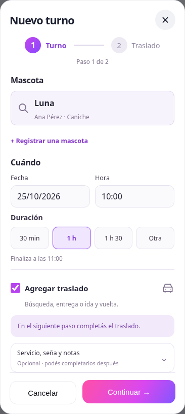
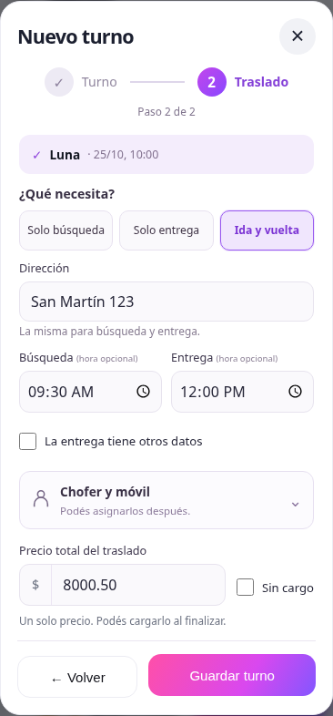
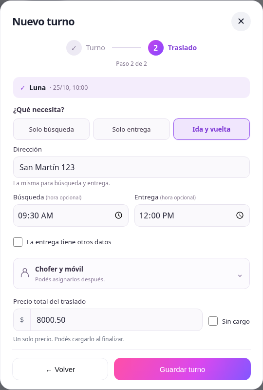

# Nuevo turno en dos pasos

El alta de Agenda aplica la propuesta visual aprobada. Cuando el turno lleva
traslado, se completa en dos pasos: Turno y Traslado. Un turno sin traslado se
guarda directamente desde el primero.

## Turno

Primero se busca la mascota por nombre o dueño, o se registra una nueva. Fecha
y hora comparten una fila. Las duraciones frecuentes son 30 minutos, 1 hora y
1 hora 30; Otra conserva las duraciones restantes y la opción personalizada.
Se muestra la hora de finalización. Servicio, seña, medio de pago de la seña y
notas siguen disponibles en una sección opcional.

Agregar traslado usa un checkbox horizontal y explica qué se completa después.
Continuar valida mascota, dueño cuando es nuevo, fecha, hora y duración. La hora
se valida en formato HH:MM, entre 07:00 y 22:00. Los campos con problemas se
identifican y reciben el foco.

## Traslado

Se elige Solo búsqueda, Solo entrega o Ida y vuelta. En ida y vuelta, dirección,
chofer y móvil se comparten. La entrega tiene otros datos permite modificarlos
por separado. Desmarcar esa opción vuelve a usar los datos compartidos; al
marcarla nuevamente, se recupera el borrador diferente de la entrega.

Los horarios de cada tramo son independientes y opcionales. Chofer y móvil se
asignan desde una sección desplegable, que también contiene las opciones de
fecha y zona por tramo. No se copian horarios, fechas o zonas automáticamente.
Las fechas sin selección propia siguen la fecha del turno; una fecha específica
se conserva cuando se cambia el turno.

Cambiar el tipo de viaje o volver al primer paso conserva los borradores y las
secciones abiertas. El precio se guarda una sola vez por solicitud y no se
duplica entre tramos. Sin cargo sigue siendo una decisión explícita; el precio
pendiente se conserva como pendiente y no genera un cobro.

## Presentación y compatibilidad

El modal tiene encabezado y acciones fuera del área desplazable. Su altura
respeta el viewport dinámico y las áreas seguras; los controles de fecha y hora
no ensanchan el formulario en pantallas chicas. El foco queda dentro del modal
y se conserva la búsqueda por teclado, la navegación entre pasos y Escape.
Durante el guardado se deshabilitan los campos y se evita cerrar el formulario.

La edición de turnos existentes conserva su circuito anterior. Los controles
compartidos de importe usan los textos Precio total del traslado y Sin cargo,
incluidas las pantallas de edición y finalización. No cambian las APIs, los
permisos, el precio único, los cobros explícitos ni los registros históricos.
No hay migraciones ni cambios de backend.

## Verificación

- Build/PWA, `npm test`, ESLint de todos los archivos modificados y nuevos, y
  `git diff --check` aprobados. El build conserva los avisos previos de PetShop
  por atributo `step` duplicado y tamaño del bundle.
- Pruebas del borrador: datos compartidos sin alterar horario, fecha, zona,
  estado o notas; datos diferentes por entrega; recuperación de tramos al
  cambiar el tipo de viaje; ausencia de importes duplicados por tramo.
- Navegador Chromium con API simulada: alta con mascota existente y nueva,
  validación de dueño, hora incompleta o fuera del rango, duraciones menos
  frecuentes y personalizada, ida y vuelta, solo búsqueda y selección de solo
  entrega; regreso entre pasos; fechas y horarios independientes; asignación
  compartida y diferente; precio pendiente y Sin cargo; error recuperable al
  guardar, seña y medio de pago, servicio y notas, alta sin traslado en un paso.
- Validación de la edición anterior con un traslado histórico en cero: editar
  notas no reclasifica su bonificación ni sus importes.
- Búsqueda por dueño y teclado, foco, Escape, controles visibles y sin desbordes
  en tamaños desde 320 × 568 hasta 1440 × 1000.

Las capturas usan datos ficticios. No se accedió a producción ni se registraron
cobros reales. Se verificó en Chromium; no se probó en un iPhone físico o Safari.
Los cambios todavía no están publicados.

## Capturas reales del formulario

