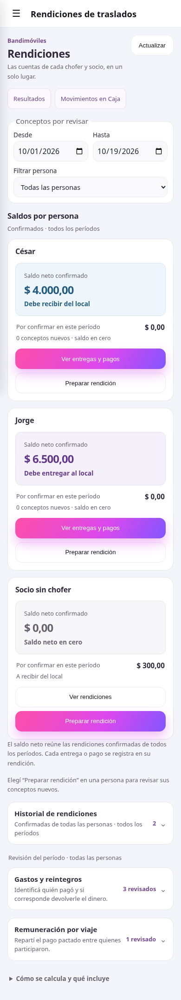
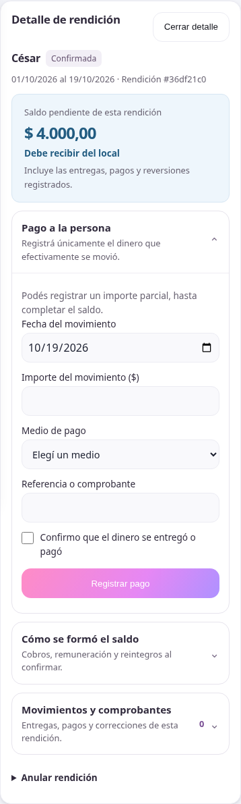
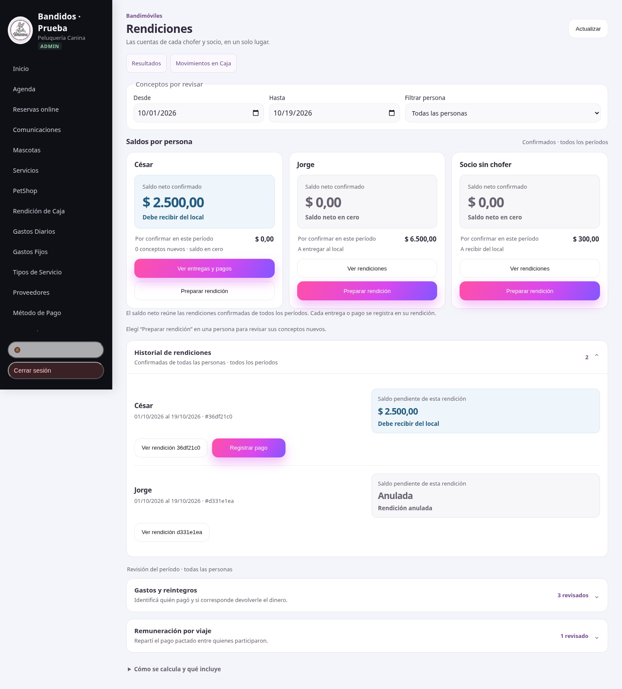

# Rendiciones: saldos y acciones en el celular

La vista principal muestra primero la cuenta de cada persona. El saldo neto
confirmado indica si debe entregar dinero al local o recibirlo. Los conceptos
del período que todavía requieren confirmación se muestran aparte, sin
sumarlos al saldo confirmado. Un saldo desconocido se presenta como «Por
revisar»; una rendición anulada se identifica como tal.

## Recorrido

- **Ver entregas y pagos** filtra a la persona y abre su historial de todos los
  períodos. Cada rendición conserva su propio saldo y su acción de registrar
  entrega o pago. El neto de una persona puede ser cero aunque tenga rendiciones
  de sentidos contrarios: el historial sigue accesible y no se compensan pagos.
- **Preparar rendición** lleva a los conceptos nuevos de esa persona y su
  desglose. Confirmar requiere revisar y marcar la casilla; no mueve dinero.
- **Antes de confirmar** agrupa los pendientes y lleva a gastos, repartos o
  Resultados para completar condiciones y jornales. Las revisiones de gastos
  y repartos abarcan todas las personas del período, incluso con un filtro.
- El detalle destaca el saldo actual y permite registrar un importe parcial.
  El desglose inicial, los conceptos, movimientos y comprobantes se despliegan
  a demanda. Las reversiones y anulaciones siguen disponibles con sus
  confirmaciones y restricciones anteriores.

Los paneles conservan su apertura al guardar. Plegarlos conserva los borradores
de sus formularios. La navegación desplaza y enfoca la sección solicitada;
al cerrar el detalle, devuelve el foco al origen o al resumen. El contenido se
muestra cuando corresponde a la selección cargada, para evitar saldos o foco
del filtro anterior mientras llega una respuesta.

El encabezado móvil identifica «Rendiciones de traslados». Los controles tienen
un área de al menos 44 px, fechas del detalle en día/mes/año y los importes
conservan centavos. No cambia la API, las fórmulas, los IDs de reintento, los
permisos ni los datos históricos. No requiere migración ni cambios del backend.

## Validación

- 22 pruebas existentes y build/PWA pasan; ESLint pasa en los archivos tocados.
  Persisten los avisos previos del build sobre `step` duplicado en PetShop y
  tamaño del bundle.
- Navegador Chromium con API Express y PostgreSQL descartable: revisión de
  gastos con/sin reintegro, reparto 60/40, confirmaciones individuales, Jorge
  entrega $6.500 y César recibe $4.000; entregas parciales de $2.500 y $4.000,
  pago parcial de $1.500, reversiones y anulación. Los ingresos operativos de
  Caja conservan sus importes y confirmar no crea movimientos automáticos.
- Saldo anterior fuera del rango consultado, error recuperable, paneles y
  borradores al plegar, retorno de foco, controles de al menos 44 px y anchos
  de 320 a 1440 px sin desborde ni errores JavaScript. El chofer conserva la
  redirección a Mis traslados.
- Casos de presentación con respuestas ficticias: neto cero con rendiciones
  de sentidos contrarios, centavos e importes grandes, nombre largo, persona
  inactiva, período vacío y paginación de 21 rendiciones.

Las capturas usan datos ficticios. Se probó en Chromium; todavía no se verificó
en un iPhone físico ni Safari. No se consultaron ni modificaron datos de producción.

## Capturas

