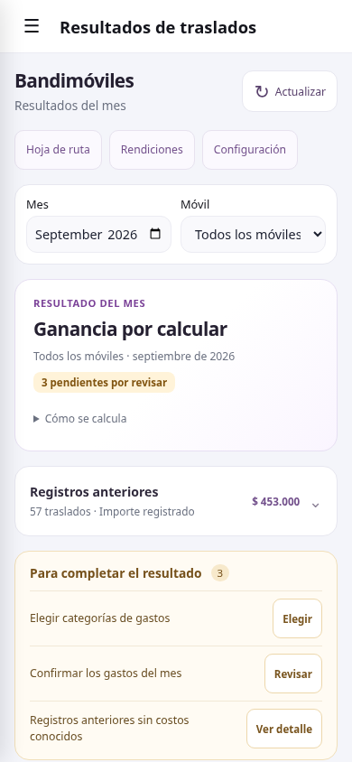
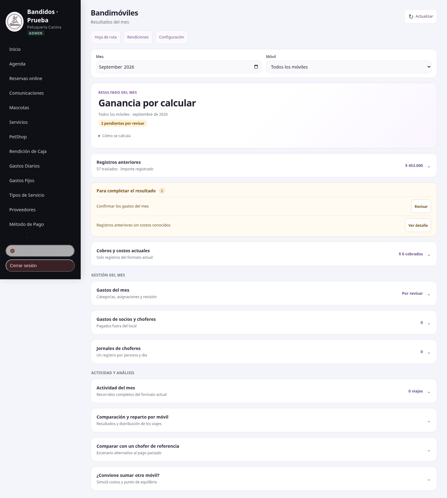

# Bandimóviles: Resultados en celular

La pantalla presenta primero el estado del resultado y los importes anteriores,
separados de los cobros actuales. Cada pendiente tiene una acción que abre su
sección o lleva a Agenda, Hoja de ruta o Gastos fijos, según corresponda.

Gastos, categorías, jornales, actividad, repartos, comparación de referencia y
simulador se despliegan por separado. Las categorías tienen buscador: filtrar
la lista no elimina selecciones. La elección se guarda explícitamente y se
informa que afecta la clasificación de todos los meses.

Las fórmulas económicas, condiciones guardadas, importes y permisos no cambian.
No requiere una migración. Los costos/cobros desconocidos siguen sin convertirse
en cero y la ganancia no incluye importes históricos sin información suficiente.

Estas capturas usan una base PostgreSQL descartable con datos ficticios. El
ejemplo de 57 traslados y $453.000 reproduce las cifras compartidas por el
usuario, sin acceder a su cuenta de producción.

## Primera pantalla en celular

## Actividad desplegada

## Escritorio

## Validación

- 22 pruebas y build/PWA pasan; ESLint de los JavaScript modificados pasa.
- Navegador a 320, 375, 390, 768, 1024 y 1440 px, sin desbordes.
- API real y PostgreSQL descartable: selección de categorías, asignación de
  gastos, costos externos con centavos, edición y revisión, condiciones por
  viaje, jornales y reparto 60/40. Caja conserva sus importes originales.
- Se verificaron pérdida, resultado cero, pendientes, fallo de consulta,
  filtro de móvil, simulador de 72 viajes/mes y acceso restringido de chofer.
